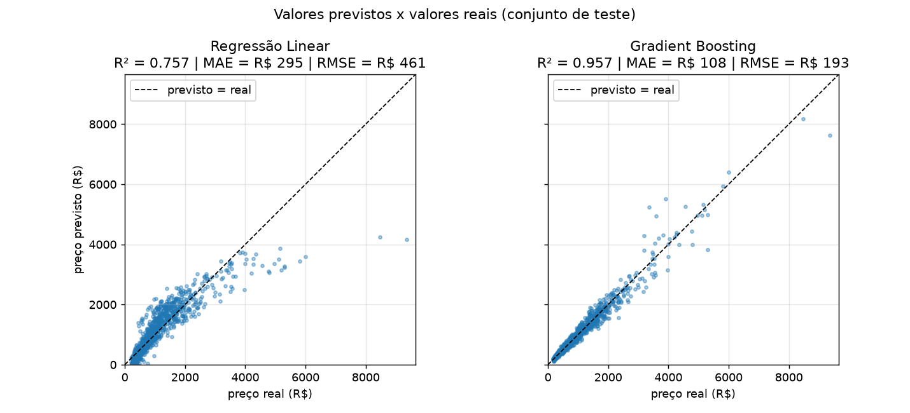
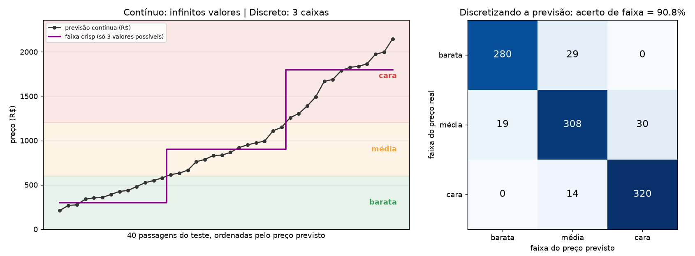
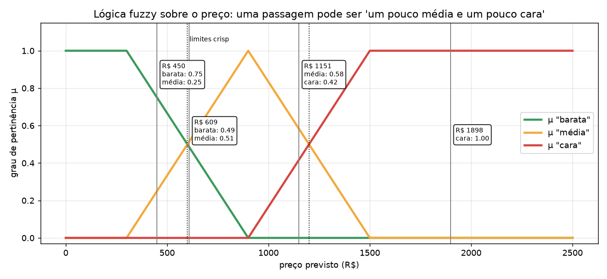

# Questão 2: Regressão do preço de passagens aéreas

Trabalho final de Lógica Nebulosa (Universidade Carioca, Prof. Mardônio França). **Questão 2: Regressão.**

O projeto prevê o **preço (R$) de uma passagem aérea**, uma variável contínua, a partir das características do voo. Ele compara uma Regressão Linear com um Gradient Boosting e discute o resultado contínuo frente à classificação discreta e à lógica fuzzy.

## Como executar

```powershell
cd questao2_regressao
pip install -r ..\requirements.txt

python gerar_dados.py      # cria dados\passagens.csv (5.000 passagens, semente 42)
python regressao.py        # treina, mede no teste e gera as figuras em resultados\   (~10 s)
python -m pytest           # 8 testes automáticos
streamlit run app.py       # interface visual (http://localhost:8501)
```

A interface tem 5 páginas: visão geral, prever o preço de um voo (com pertinência fuzzy), comparação dos modelos, contínuo × fuzzy e entenda o código. Treina os modelos na primeira abertura (~10 s) e lê as figuras de `resultados\`, então rode `gerar_dados.py` e `regressao.py` antes.

## Dados (sintéticos)

> **Atenção: os dados são SINTÉTICOS.** Não existe uma base pública de preços de passagens que rode offline e sem cadastro. Por isso, `gerar_dados.py` cria os preços a partir de uma **regra conhecida mais um ruído aleatório**. As companhias são fictícias e as distâncias entre as cidades são aproximadas. A vantagem didática é que sabemos *o que* o modelo deveria aprender e podemos checar se ele aprendeu (veja a importância das variáveis).

| Variável | Tipo | Valores |
|---|---|---|
| `distancia_km` | numérica | 16 rotas entre capitais (340 a 3.210 km) |
| `antecedencia_dias` | numérica | 0 a 180 dias (a maioria compra perto da data) |
| `escalas` | numérica | 0, 1 ou 2 |
| `alta_temporada` | 0/1 | dezembro, janeiro e julho |
| `companhia` | categórica | VoaBrasil, CéuAberto, Andorinha (low cost) |
| `classe` | categórica | econômica, executiva |
| `dia_semana` | categórica | seg … dom |
| `periodo_dia` | categórica | madrugada, manhã, tarde, noite |
| **`preco`** | **alvo** | R$ 108 a R$ 9.379 (mediana R$ 905) |

Regra (todos os fatores multiplicam): `preço = (90 + 0,38·km) × companhia × classe × (1 + 1,2·e^(−dias/12)) × escalas × dia × temporada × período × ruído`, com ruído lognormal de cerca de 10%. Os valores exatos estão no topo de `gerar_dados.py`.

## a) Divisão, modelos e treino

- **Divisão:** 80% treino (4.000) e 20% teste (1.000), `train_test_split(random_state=42)`.
- **Pré-processamento** (`ColumnTransformer`, dentro do `Pipeline`, ajustado só no treino): as variáveis numéricas são padronizadas com `StandardScaler` e as categóricas viram colunas 0/1 com `OneHotEncoder`.
- **Modelos:**
  - **Regressão Linear**: preço = soma de pesos × atributos. É a referência simples.
  - **Gradient Boosting** (`HistGradientBoostingRegressor`, 400 árvores, taxa 0,05): soma de muitas árvores pequenas, cada uma corrigindo o erro das anteriores. Capta efeitos **não lineares** (a antecedência é exponencial) e **interações** (os fatores se multiplicam).

## b) Métricas no conjunto de teste

| Modelo | MAE (R$) | MSE (R$²) | RMSE (R$) | R² |
|---|---|---|---|---|
| Regressão Linear | 294,73 | 212.281 | 460,74 | 0,757 |
| Gradient Boosting | **107,66** | **37.134** | **192,70** | **0,957** |

- **MAE**: erro médio absoluto. O Gradient Boosting erra, em média, R$ 108 por passagem.
- **MSE**: média dos erros ao quadrado. Pune muito os erros grandes; a unidade é R$².
- **RMSE**: raiz do MSE, de volta em R$. Como RMSE > MAE, há alguns erros grandes (passagens executivas caras).
- **R²**: fração da variação do preço explicada pelo modelo. O Gradient Boosting explica 95,7%; o restante corresponde basicamente ao ruído de cerca de 10% que colocamos nos dados.

A Regressão Linear perde porque a regra é **multiplicativa e não linear**: a executiva custa 2,6× em qualquer distância, e a compra de última hora encarece de forma exponencial. Uma reta não consegue representar isso, o que se vê na curvatura do gráfico abaixo.



Figuras adicionais:
- `resultados/residuos.png`: erros em torno de zero.
- `resultados/importancia_variaveis.png`: distância, classe e antecedência são as variáveis mais importantes, exatamente como na regra que gerou os dados.

## c) Contínuo × discreto

- **Classificação (Q1):** a saída é **discreta**, um rótulo dentre um conjunto finito ({cachorro, não cachorro}, 2 valores possíveis).
- **Regressão (Q2):** a saída é **contínua**, um número real em R$. No teste, o modelo produziu **996 valores distintos em 1.000 passagens**. Entre R$ 590 e R$ 609 existem infinitos preços possíveis, e a diferença entre eles tem significado (R$ 19).

Para comparar, `regressao.py` **discretiza** a previsão em faixas crisp: barata < R$ 600 ≤ média < R$ 1.200 ≤ cara. Com isso, a regressão vira uma classificação de 3 classes, com **90,8% de acerto de faixa**:



Ao discretizar, perde-se informação:
- R$ 610 e R$ 1.150 viram a mesma "média", embora um seja quase o dobro do outro;
- R$ 590 ("barata") e R$ 609 ("média") ficam em classes diferentes por R$ 19;
- os erros da matriz ficam todos nas fronteiras vizinhas (nunca de "barata" para "cara"), justamente onde o corte crisp é arbitrário.

## d) A lógica nebulosa já está no resultado contínuo

Na lógica fuzzy, um elemento pertence a um conjunto com um **grau** entre 0 e 1, e não apenas "sim/não". O resultado contínuo da regressão **já carrega essa gradação**: R$ 1.150 não é "médio" ou "caro" de forma absoluta, é *um pouco* de cada. Basta definir funções de pertinência sobre o valor previsto (`regressao.pertinencias()`):

| Termo | Função de pertinência |
|---|---|
| "barata" | 1 até R$ 300, cai até 0 em R$ 900 |
| "média" | triângulo R$ 300 → 1 em R$ 900 → 0 em R$ 1.500 |
| "cara" | 0 até R$ 900, sobe até 1 em R$ 1.500 |

As funções se cruzam (μ = 0,5) exatamente nos limites crisp R$ 600 e R$ 1.200 e somam 1 em todo ponto.



Exemplos reais do teste (`resultados/exemplos_pertinencia.csv`):

| Preço real | Previsto | Faixa crisp | μ barata | μ média | μ cara |
|---|---|---|---|---|---|
| R$ 421,58 | R$ 449,88 | barata | 0,75 | 0,25 | 0 |
| R$ 582,03 | R$ 590,07 | barata | **0,52** | **0,48** | 0 |
| R$ 647,83 | R$ 608,96 | média | **0,49** | **0,51** | 0 |
| R$ 859,70 | R$ 902,80 | média | 0 | 0,99 | 0,01 |
| R$ 1.178,52 | R$ 1.150,61 | média | 0 | 0,58 | 0,42 |
| R$ 1.210,97 | R$ 1.248,77 | cara | 0 | 0,42 | 0,58 |
| R$ 1.686,60 | R$ 1.997,13 | cara | 0 | 0 | 1 |

- A versão crisp diz que R$ 590 e R$ 609 são de classes diferentes. A versão fuzzy diz que eles são **praticamente iguais** (≈ 0,5 / 0,5), que é a leitura humana correta.
- **A regressão é a forma "não defuzzificada" do problema.** Na Q1 o modelo calcula um grau (a probabilidade) e o corte em 0,5 o transforma em rótulo. Na Q2 o próprio resultado já é o valor contínuo, e qualquer classificação ("barata/cara") é uma etapa posterior, fuzzy ou crisp.
- Também há incerteza em torno do número: o RMSE de R$ 193 diz que a previsão R$ 1.150 é, na prática, "algo entre ~R$ 960 e ~R$ 1.340". O valor previsto é o centro de uma estimativa, não uma verdade exata.

## Arquivos

| Arquivo | O que faz |
|---|---|
| `gerar_dados.py` | Gera `dados/passagens.csv` com a regra documentada + ruído |
| `regressao.py` | Divisão, modelos, métricas, gráficos, contínuo × discreto, pertinência fuzzy |
| `tests/test_regressao.py` | Testes: reprodutibilidade, regra do preço, métricas à mão, faixas, pertinências, desempenho |
| `resultados/` | `metricas.csv`, `previsoes_teste.csv` (com μ de cada passagem), `exemplos_pertinencia.csv`, `faixas_matriz.csv` e as figuras |
