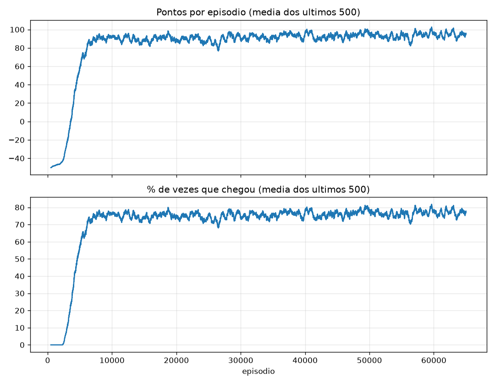
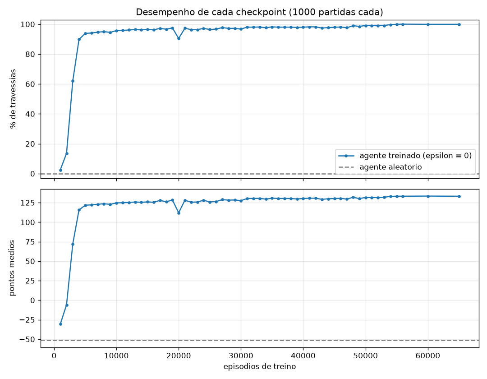
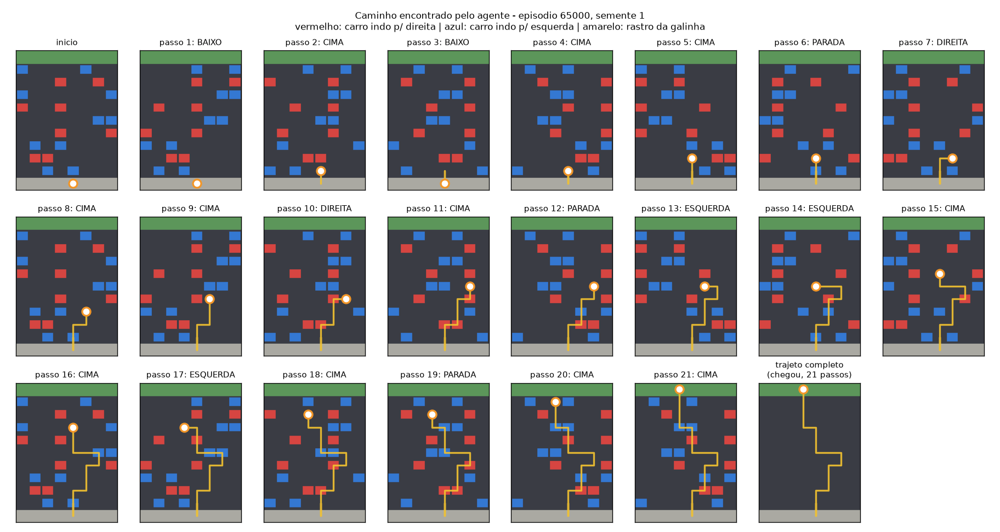
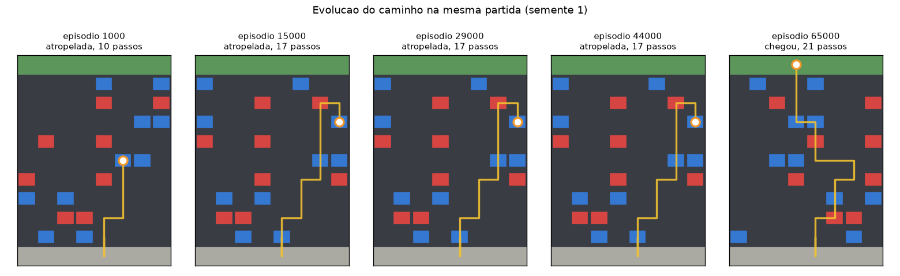

# Galinha atravessando a rua: Q-learning

Trabalho final de Lógica Nebulosa (Universidade Carioca, Prof. Mardônio França).
**Questão 3: Aprendizado por reforço.**

Uma galinha precisa atravessar uma rua de 9 pistas com carros em movimento. Ela aprende sozinha, por tentativa e erro, usando **Q-learning tabular** implementado do zero (sem bibliotecas de RL). É uma variação do problema do labirinto sugerido no enunciado: em vez de paredes fixas, os obstáculos (carros) se movem e são sorteados a cada partida.

## Como executar

Requer Python 3.10+.

```bash
pip install -r requirements.txt

python treinar.py --do-zero --episodios 20000 --checkpoint-cada 1000   # treina do zero
python avaliar.py                                                     # gera as figuras de resultado
python visualizador.py                                                # galinha treinada jogando (pygame)
python visualizador.py --treinar --do-zero                            # treino ao vivo na tela (T = turbo)
python -m pytest                                                      # testes automáticos (12 testes)
```

O treino de 20.000 episódios leva cerca de 1 minuto. Os checkpoints do treino que usei já estão em `checkpoints/` (um a cada 1.000 episódios até o 56.000, depois 60.000 e 65.000; o `ultimo.pkl` está no episódio 66.717), então `avaliar.py` e `visualizador.py` funcionam sem treinar de novo.

> `checkpoints/treino_antigo_19-10/` guarda um checkpoint de um treino anterior (ep. 57.000), separado para não entrar na evolução que o `avaliar.py` analisa. **Cuidado:** `treinar.py --do-zero` e `visualizador.py --treinar` sobrescrevem os checkpoints da pasta.

| Arquivo | O que faz |
|---|---|
| `galinha_env.py` | Ambiente: mapa, carros, estados, ações e recompensas (nenhum aprendizado aqui) |
| `treinar.py` | Agente: tabela Q, política epsilon-greedy, equação do Q-learning, checkpoints |
| `avaliar.py` | Avalia os checkpoints e gera as figuras em `resultados/` |
| `visualizador.py`, `visual.py` | Demonstração gráfica em pygame |
| `tests/test_galinha.py` | Testes: regras do ambiente, recompensas, equação do Q-learning, checkpoints, agente treinado |

## a) Ambiente e agente

**Mapa:** grade de 11 linhas × 8 colunas. Linha 0 = calçada (início), linha 10 = grama (chegada), linhas 1 a 9 = pistas com 2 carros cada. Pistas pares andam para a direita e ímpares para a esquerda, uma casa por turno, com *wrap-around*. As posições dos carros são sorteadas a cada episódio.

**Estados:** tupla `(linha, coluna, frente_ocupada, frente_vindo, aqui_vindo)`.

| Componente | Significado |
|---|---|
| `linha`, `coluna` | posição da galinha (0 a 10, 0 a 7) |
| `frente_ocupada` | há carro na casa logo acima agora? (0/1) |
| `frente_vindo` | um carro vai chegar na casa de cima no próximo turno? (0/1) |
| `aqui_vindo` | um carro vai chegar na casa da galinha no próximo turno? (0/1) |

São 11 × 8 × 2 × 2 × 2 = **704 estados** possíveis (em vez de ~10¹³ se o estado fosse o mapa inteiro).

**Ações:** `CIMA`, `BAIXO`, `ESQUERDA`, `DIREITA`, `PARADA`.

**Recompensas:**

| Evento | Recompensa |
|---|---|
| cada passo | −1 |
| alcançar uma linha mais alta que todas as anteriores | +5 |
| ser atropelada (fim do episódio) | −50 |
| chegar do outro lado (fim do episódio) | +100 |

O episódio também termina após 100 passos.

**Agente (Q-learning):** tabela Q `estado → 5 valores`, política epsilon-greedy e a atualização

```
Q(s,a) ← Q(s,a) + α · [ r + γ · max_a' Q(s',a') − Q(s,a) ]
```

com α = 0,1, γ = 0,95 e ε decaindo de 1,0 até 0,05 (fator 0,9995 por episódio).

## b) Evolução do aprendizado e caminho final

Todas as figuras são geradas por `python avaliar.py`.

**Evolução durante o treino** (`resultados/curva_aprendizado.png`): média móvel de 500 episódios dos pontos e da taxa de travessia. A curva sai de −50 pontos / 0%, sobe rápido entre os episódios 2.000 e 6.000 (quando ε cai de 0,37 para 0,05) e estabiliza perto de +90 pontos / 75% a 80% a partir do episódio 8.000. Esses valores incluem as 5% de ações aleatórias da exploração.



**Desempenho de cada checkpoint sem exploração** (`resultados/evolucao_checkpoints.png`): cada checkpoint joga as mesmas 1.000 partidas com ε = 0.

| Agente | Travessias | Pontos médios | Passos médios |
|---|---|---|---|
| aleatório | 0,0% | −51,2 | 7,5 |
| episódio 1.000 | 2,5% | −30,7 | 10,2 |
| episódio 2.000 | 13,6% | −5,9 | 14,2 |
| episódio 3.000 | 62,0% | 72,1 | 17,2 |
| episódio 5.000 | 93,8% | 121,7 | 18,5 |
| episódio 10.000 | 95,7% | 124,7 | 18,6 |
| episódio 20.000 | 90,4% | 112,0 | 23,7 |
| episódio 30.000 | 96,7% | 127,6 | 17,0 |
| episódio 56.000 | 100,0% | 133,3 | 16,7 |
| episódio 65.000 (final) | **99,9%** | **133,3** | **16,6** |

A curva não é monotônica (o episódio 20.000 piorou em relação ao 10.000): com α = 0,1 e ε = 0,05 a tabela Q continua oscilando, e um checkpoint pode estar num momento ruim. Por isso a avaliação usa 1.000 partidas fixas e sem exploração. Depois do episódio 50.000 todos os checkpoints ficam entre 99% e 100%, então treinar além disso quase não muda nada.



**Caminho final** (`resultados/caminho_final.png` e `resultados/caminho_final.txt`): uma partida jogada pelo agente final (episódio 65.000), quadro a quadro. Ele atravessa em 21 passos (129 pontos), recuando (`BAIXO` nos passos 1 e 3), esperando (`PARADA` nos passos 6, 12 e 19) e desviando para os lados quando um carro se aproxima.



**Evolução do caminho** (`resultados/caminho_evolucao.png`): a mesma partida jogada por checkpoints de épocas diferentes. Esta partida é difícil: no episódio 1.000 a galinha sobe direto e é atropelada na pista 4; nos episódios 15.000, 29.000 e 44.000 ela já chega até a pista 7, mas cai sempre na mesma armadilha; só o agente final (65.000) escapa e atravessa.



Como os carros são sorteados a cada partida, não existe um único caminho ótimo fixo como num labirinto: o agente aprende uma **política** que reage ao trânsito. Para ver o caminho de outra partida: `python avaliar.py --semente 7`.

## Limitações

- O estado é "míope": não vê carros nas laterais nem a duas casas de distância, o que explica as falhas que ainda aparecem em alguns checkpoints.
- A tabela Q só é viável porque o estado é pequeno; problemas maiores exigiriam aproximação de função (ex.: Deep Q-Learning).
